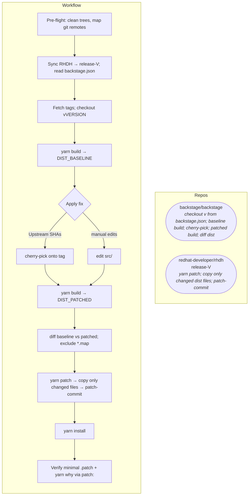

# rhdh-patch-backstage workflow (Mermaid)

Companion diagram for [`SKILL.md`](../SKILL.md). Render in GitHub, GitLab, VS Code (Mermaid preview), or docs tooling.

## Overview

One flow: **backstage/backstage** at the **`backstage.json`** release tag is built **twice** (before and after the fix). **Only** dist files that differ between those builds are copied into the Yarn patch temp. **RHDH** pins that minimal set onto the lockfile version.

Step-by-step detail, troubleshooting, and **dynamic-plugins** (second Yarn project) are in [`SKILL.md`](../SKILL.md).
